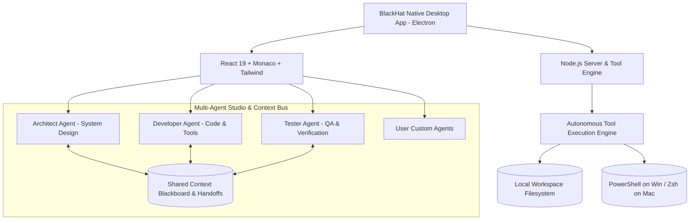

# BlackHat: Autonomous Multi-Agent IDE (macOS & Windows)

**BlackHat** is a state-of-the-art native desktop IDE inspired by Google Antigravity IDE, engineered for **Simultaneous Multi-Agent Execution**, **Inter-Agent Context Exchange**, and **Developer Workflow Autonomy**.

Runs natively as an Electron desktop application on both **macOS** and **Windows**, as well as in the browser.

---

## ⚡ Core Features

### 1. Tri-Agent Studio (`ARCHITECT`, `DEVELOPER`, `TESTER`) + Custom Agents
- **Architect**: High-level system design, technical contracts, modular breakdown, and task planning.
- **Developer**: Full-stack code generation, refactoring, tool calling, and feature delivery.
- **Tester**: Automated test suites, edge case validation, security boundaries, and regression prevention.
- **Custom User Agents**: Create specialized agents (e.g. *DevOps / SRE*, *Security Auditor*, *Database Specialist*) with custom system prompts, avatars, models, and providers via the **+ Add Agent** modal.
- **Dual Execution Layouts**: Toggle between **Vertically Stacked Panes** (simultaneous parallel live execution) and **Tabbed Agent Studio**.

### 2. Multi-Agent Context Exchange Bus
- **Inter-Agent Blackboard**: Agents can publish architectural plans, code implementations, or test matrices directly to the shared context bus.
- **One-Click Handoffs**: Direct handoff between agents (e.g., Architect hands off specs to Developer; Developer passes code to Tester; Tester hands back edge cases).
- **Workspace-Aware Context**: Automatically synchronizes the active editor file, git state, and recent inter-agent deliverables.

### 3. Google & GitHub Authentication
- **OAuth Identity Support**: Sign in with **Google** or **GitHub** accounts.
- **Profile Synchronization**: Displays user avatars, linked identity providers, and active subscription tiers (`Free`, `Pro`, `Enterprise`).

### 4. Extensions Store & Marketplace
- **Built-in Extensions Store**: Browse, search, filter, install, and manage IDE extensions directly from the Activity Bar (`Cmd + Shift + X`).
- **Curated Extensions**:
  - *Google Gemini Code Assist*
  - *Claude Code Companion*
  - *OpenAI Codex & Copilot*
  - *REA Reverse Engineering Suite*
  - *Python Intelligence Server (Pylance)*
  - *Tailwind CSS IntelliSense*
  - *Prettier - Code Formatter*
  - *Antigravity Obsidian Cyberpunk Theme*

### 5. Bring Your Own Subscriptions (BYOS) & API Keys
Users with existing paid subscriptions can use their accounts directly without metered API fees:
- **Google Gemini**: Gemini Advanced / Google One AI Premium / Google AI Studio (Gemini 2.5 Pro & Flash)
- **Anthropic Claude**: Claude Pro / Claude Code subscription (Claude 3.7 Sonnet & Extended Thinking)
- **OpenAI Codex**: ChatGPT Plus / Team / Codex (GPT-4o, o1, o3-mini)
- **Local Ollama**: Fully local offline models (Llama 3.2, DeepSeek, Qwen)

### 6. Native OS Integration (macOS & Windows)
- **macOS Native Support**: Integrated window chrome with native traffic light positioning (`titleBarStyle: 'hiddenInset'`), obsidian dark vibrancy, and smooth drag regions.
- **Windows Native Support**: Seamless Windows titlebar overlay with native minimize, maximize, and close controls.
- **Single-Instance Protection**: Enforces `app.requestSingleInstanceLock()` and headless background server management to guarantee zero runaway processes or window cascades.

---

## 🔄 How Installed App Updates Work

### Does Pushing to GitHub Automatically Update an Installed App?
**No.** Pushing code commits to a git repository only updates the source code. A compiled desktop application running on a user's machine (`.app` on macOS or `.exe` on Windows) is an installed binary bundle and does not monitor git commits directly.

### How Auto-Updates Function in Production
1. **GitHub Releases Pipeline**:
   When new code is ready, a new release version is tagged (e.g. `v1.1.0`) and packaged (`npm run dist`). Electron-builder uploads the compiled installer (`.dmg`, `.zip`, `.exe`) along with update manifest files (`latest-mac.yml`, `latest.yml`) to **GitHub Releases**.
2. **In-App Auto-Updater (`electron-updater`)**:
   The desktop app connects to the GitHub repository's release feed. When a new version is detected:
   - A banner notifies the user: *"Version 1.1.0 available"*.
   - The delta update downloads silently in the background.
   - The user clicks **Restart & Update** to apply the new version seamlessly.

---

## 🚀 Running BlackHat

### Run as Native Desktop App (macOS & Windows)
```bash
npm run electron
```
This starts the backend server, launches Vite, and opens the native **BlackHat** desktop window.

### Run in Browser
```bash
npm start
```
Then visit **[http://localhost:5173](http://localhost:5173)**.

---

## 📦 Packaging for Distribution

### Package for macOS (.dmg, .app, .zip)
```bash
npm run pack:mac
```
Output binaries will be placed in the `release/` directory.

### Package for Windows (.exe installer, portable)
```bash
npm run pack:win
```
Output installer and portable `.exe` will be placed in the `release/` directory.

---

## 📐 Architecture


